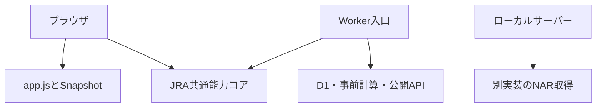

# CHASS アプリ内部整合性監査 v1

基準main: `de7ad074e3426fa15d4f8da1cbea164a1699847d` / tree: `d92d8ca3e7a0172ec86188b41a6d3eb494b38e6a`。
この監査は上記mainと完全一致するローカルツリーから開始した。変更は修正案であり、GitHubへの反映・merge・deployとは別。

## 結論

全体が統合済みとは判断できない。共通化できている能力コアと、複数の読み取り・保存・研究経路が混在している。先にEARLYデータの所有権と評価基準を揃え、研究機能の昇格を明示する。その後に勝ち切り精度を研究する。

今回、4つの再現可能な読み取り・検証の問題を修正した。予想式・重み・シミュレーション・正式⚠️/💎の付与条件は変更していない。既存の固定Snapshotを書き換えたり、過去データを再生成・補修したりしない。

## 調査範囲と限界

- root / `src/` のJavaScript・ESMを177ファイル確認対象に列挙。`src/prediction/` 73、`src/research/` 75。これはファイル数であり、独立した機能数ではない。
- `index.html`、ブラウザbootstrap、`worker-entry.mjs`、`worker.js`、`server.mjs`、主要Snapshot/KPI/研究経路、wrangler設定、テストとworkflowを確認した。
- 全177ファイルの意味を逐行証明した監査ではない。手動の主要経路レビュー、リテラル参照の棚卸し、再現テストと既存回帰テストの組合せである。
- 実D1・実localStorage・Productionの環境変数・Cloudflareの実デプロイ版は確認していない。設定ファイルと実環境の一致は不明。実レース取得・診断API・研究collectorも起動していない。
- 参照graphは呼び出し実績ではない。特にserverはworkerのparserをimportするためWorker依存がgraph上で到達しても、全APIを提供するわけではない。
- 直前mainのGitHub CI 3,143件通過と、この修正案のローカル検証は別の証拠として扱う。ローカル全体テストはChrome/MCP SDKの不足を含むため全件PASSとしない。

## 実際の構成



### 機能台帳

機械可読の所有権台帳は `config/app-feature-ownership-v1.json`。追加機能を有効化する設定ではない。

| 機能 | 確認できた状態 | 整理すべき点 |
|---|---|---|
| JRA能力コア | ブラウザと事前計算で共通core/projectorを参照 | この共通化は維持する |
| ブラウザ正式予想 | app.js、jra-model.js、jra-adapter.jsの段階処理 | 能力と市場シグナルの責任を分ける |
| CPSI/Wave | bootstrapで読み込み、新規SnapshotにShadow添付 | 入力freeze/正規指数の準備なしはHOLD。正式能力の置換ではない |
| コースWeb Shadow | bootstrapで評価用callableを公開 | opt-in準備状態。自動採用ではない |
| コースWorker adapter | 研究モジュールのみ | Workerへの実接続なし。統合済みと呼ばない |
| Favorite v2.1.1 | 研究モジュールのみ | 正式⚠️や勝ち切りモデルを置き換えていない |
| Final5除外監査 | 研究モジュールのみ | 未見検証と実入力接続は別工程 |
| POST頑健性監査 | 研究モジュールのみ | PREの入力に混入させず、実台帳で使う |
| NAR initial/early session | CLI用研究経路 | ブラウザ・Workerの自動取得とは別 |
| favorite-risk collector | Worker入口のresearch route/scheduled処理 | Favorite v2.1.1とは別物。既存の保存経路として台帳に残す |
| NAR事前計算viewer | Worker内のresearch precompute | 自身の版・由来・flagsがあり、ブラウザ予想と同一とは保証しない |
| ローカルサーバー | 一部取得と静的配信、D1公開APIは503 | Workerと同等の検証環境として扱わない |

「import可能」「画面に出る」「実データで動く」「正式KPIに使える」「Production昇格可能」を分ける。研究機能を未接続にしていること自体はバグではない。未接続ファイルを不要として削除しない。

## 修正した4件

### 1. 削除された固定層が検証を通過する

`verifySnapshotIntegrity` は存在する層だけ比較していたため、seal後にpredictionSnapshotを削除しても `verified:3/3` となった。

修正後はsealで宣言された層の欠落、不正digest、未知の層、存在するのにseal対象から落ちた層を検出しinvalidとする。データを再生成・再sealして誤魔化さない。

### 2. 空のsealが固定確認済になる

`hashes:{}` が `verified:0/0` として通過していた。

修正後は空、不正なmap、予想層のhash欠落、未知のalgorithmをinvalidとする。もともとsealがない旧データはlegacyのまま。FNVは整合性検出用であり、出典の真正性・暗号署名・実際の発走前を証明しない。

### 3. 空の凍結根拠へ後の根拠が残る

`applyFrozenSignalSnapshot` は保存されたlongshotReasonsが空だと復元しなかった。元の根拠が空なのに後の根拠が残った。

修正後は空もそのまま復元する。根拠欠落を後の材料で補わない。凍結された印を強くしたり、保存内容を書き換えたりしない。

### 4. FINAL/市場の結合で元の能力・確率を上書きする

`frozenHorses` とcloud復元が `{...prediction,...market,...final}` を使用していた。合成の矛盾ケースで、予想勝率25がFINALの99で上書きされた。

修正後は予想Snapshotが能力・確率・TIME・馬のidentityを所有する。市場とFINALは名前を列挙した市場/表示フィールドだけを結合する。欠損した予想確率をFINALから作らない。cloud復元と集計の読み取りを同じ関数へ集約し、JRA検証サマリーも同じ読み取りを使用する。返すviewの変更で保存Snapshotを変えない。

既存のFINAL選択や時系列の真正性を、この修正だけでEARLY正式KPIと認証するわけではない。FINALの表示用rank/markは引き続きFINAL由来である。読み取りviewは正式EARLY証拠台帳の代わりにならない。

## 残る統合課題

| 優先 | 確認できた事実 | 次の作業と完了条件 |
|---|---|---|
| P0 | generic dashboardはFINALのtop3や複合viewを集計。証拠付きEARLY評価は別モジュール | 正式EARLY台帳と互換/参考集計を明示的に分離。欠損を推定せず除外理由と母数を出す。T15/T5欠損だけでEARLYを除外しない |
| P0 | browserのmark生成とJRAモデルの市場評価には別の実装が存在 | Signal policyのownerを1つに決定し、JRA/NAR・市場あり/なし・取消・後着市場の同入力比較を固定。過去のSignal Freezeは移行で再計算しない |
| P1 | appにはlegacy波乱度とCPSI/Wave Shadowが併存 | 名前・版・入力・用途を明示。CPSIを能力の唯一の研究authorityとして使う境界adapterを作り、正規入力がない場合HOLD。正式ロジックへ無検証で差し替えない |
| P1 | WorkerとserverにNAR card/result parserの重複。serverは結果Top3中心で返却構造も異なる | 副作用のないparserとDTOを共通化し、同じ保存済み公式fixtureで出力差を説明。D1のないlocalの503は維持し、偽の成功にしない |
| P1 | 設定・browserデフォルト・Worker route・workflowでflagsの扱いが異なる | 実効設定の一覧と環境別の責任を整理。browser auto-loadとWorker direct-fetchは別スイッチとして命名・監査。repo値だけで実環境ON/OFFを断定しない |
| P1 | 通常healthは研究機能の入力準備・未接続・HOLD理由を網羅しない | read-onlyな機能状態の表示契約を設計。処理を開始するhealthにはしない |
| P2 | Favoriteは勝ち切り未実装。Prediction Axis候補は別の未採用モデル | 同一freezeでWin/Top3の別目標を未見検証。追加候補が既存5頭の誰と比較して妥当かを測る。適中日のみ・大払戻依存で昇格しない |

## 強化順序

1. この4件の読み取り修正を回帰検証し、レビュー用PRへ。自動merge/deployはしない。
2. 正式EARLYの唯一の読み取り・集計契約を決める。race/circuit/runner/Run/Freeze/モデル版/出典/結果の結合を照合する。
3. Signal policyとCPSIのauthority境界を統一する。既存の強みを同入力比較で保持する。
4. 実データを通す研究runnerと状態一覧を整える。失敗や欠損をHOLDとして残し、合成テストと区別する。
5. その土台でFinal5除外、勝ち切りとTop3、条件別CPSI不確実性、回収の頑健性を未見検証する。

## 再確認コマンド

```sh
node scripts/audit-app-architecture-v1.mjs
node --test tests/app-snapshot-read-contract.test.mjs tests/snapshot-integrity-transport.test.mjs tests/signal-policy-v1.test.mjs tests/market-ev-consistency.test.mjs tests/active-race-integrity.test.mjs tests/chass-cpsi-wave-snapshot-v1.test.mjs
npm run check
```

architecture checkerの成功は宣言された参照境界が一致する意味に限定する。静的graphの取得成功を整合性全体・動作・予想精度・Productionの成功と解釈しない。checksの詳細値と制約は引き継ぎJSON/ログに記録する。

## 固定ルールと作業境界

ユーザー指定「⚠️と💎の取り扱いルール.txt」を基準とし、EARLYの正式性、人気範囲、シナリオ要件、⚠️と◎○▲△☆の排他、低EVだけで⚠️にしないこと、後の情報をLiveに分離することを維持する。新しいモデルやしきい値を勝手に採用しない。

Formal KPI HOLD / Probability MODEL_HOLD / Production Activation NO-GO。実運用エラー全体の解消、NAR smoke成功、ログ比較監査の完了は主張しない。D1書き込み、localStorage保存、EARLY Freeze、設定変更、workflow変更、merge、deployは本監査では行っていない。

確認元: https://github.com/h762-arch/-chass-keiba-lab/commit/de7ad074e3426fa15d4f8da1cbea164a1699847d
